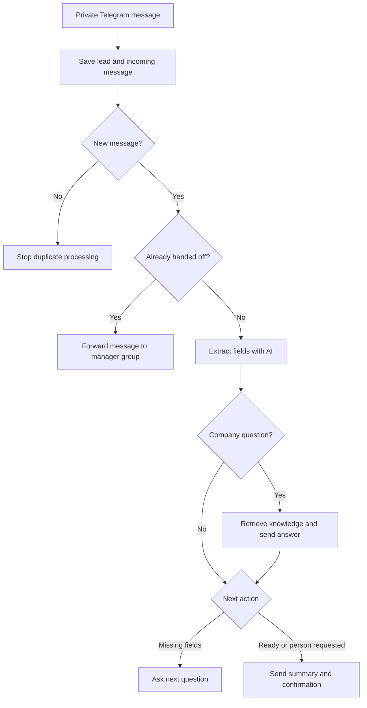

# Lead Intake & Handoff

[Русская версия](README_RU.md)

A demonstration Telegram assistant for a fictional apartment renovation company.

Built with n8n, PostgreSQL and OpenAI. The bot collects renovation requirements, answers questions using retrieved company information, and sends a structured summary to a shared manager group. Further customer messages are forwarded to that group.

**Project status: 5 November 2026.** The main flow, RAG, selected edge cases, monitoring alerts and one status recovery scenario were manually checked in the configured environment. Business impact has not been measured.

**Repository scope:** two sanitized workflow exports, a reconstructed database schema, fictional company knowledge and documentation. Public exports passed static JSON and connection checks; a clean deployment has not yet been executed.

---

## Business Problem

Renovation requests arrive as free-form messages. A manager needs the renovation type, apartment area, city, preferred start date, budget and contact details. The assistant gathers this information, answers questions about company terms, and prepares a summary. Customers can request a person before completing the questionnaire.

Estimates, appointments and commercial commitments remain outside the automated flow.

## My Role

Defined the demo scenario, assembled and configured the workflows, connected Telegram, PostgreSQL and OpenAI, and tested intake and handoff with database checks.

Development was assisted by AI. My work included configuring structured extraction, reviewing SQL and routing, investigating repeated questions, separating customer-supplied names from Telegram profile names, and checking delivery against stored statuses.

## Current Workflow Architecture

The diagram shows the business flow. The export also includes the private-chat filter, a separate `/start` greeting and SQL steps that store send results and processing status.

## How It Works

1. A private-chat filter excludes manager-group messages before lead creation.
2. PostgreSQL saves the lead and incoming text before AI. A unique constraint and an IF node stop a repeated Telegram message ID within the same lead.
3. AI extracts current-message fields through Structured Output Parser. SQL merges non-null values into the stored lead.
4. For a company question, AI selects a search topic. PostgreSQL returns up to three passages, and a second chain answers from them before the questionnaire continues.
5. JavaScript chooses the next question or handoff. An explicit request for a person does not require a completed questionnaire.
6. A pending handoff is created. Successful summary delivery is recorded with its Telegram message ID and `sent` status.
7. The lead becomes `handed_off`. After customer confirmation, its ID is saved and the source message becomes `done`.
8. Further messages go to the manager group. Routing employee replies back to customers is not implemented.

## Data and States

| Table | Purpose |
| --- | --- |
| `leads` | Contact, collected fields, skipped fields and state |
| `messages` | Incoming text and processing status |
| `handoffs` | Summary, destination and primary send results |
| `repair_knowledge` | Six fictional retrieval topics |

| Record | Main implemented transition |
| --- | --- |
| Lead | `collecting` → `handed_off` |
| Handoff | `pending` → `sent` |
| Incoming message | `pending` → `done` |

Other values permitted by database constraints do not imply implemented workflow branches.

## Knowledge Retrieval

PostgreSQL full-text search uses the Russian language configuration. AI converts a question such as “Do you work officially?” into a topic such as “contract”. Retrieved passages are passed to the answer chain.

This is lexical RAG without embeddings or pgvector. Unsupported questions receive a suggestion to ask a manager, rather than invented terms. That response does not itself create a manager task or append the question to the summary.

## Error Handling

Three selected SQL nodes have three attempts with 1-second waits. Telegram sends do not use blind retries: a message may have arrived before the response was lost.

A scheduled workflow alerts on incoming messages and handoffs pending for more than five minutes. Stored alert times limit repeat notifications to once per hour per record.

A separate branch restores a lead from `collecting` to `handed_off` if its confirmed handoff is `sent`, has a Telegram message ID and is older than five minutes. This was checked using a deliberately modified test record.

Ambiguous sends require manual inspection. Automatic redelivery and exactly-once delivery are not implemented. Details: [recovery guide, Russian](docs/recovery.md).

## Key Architecture Decisions

- Persist incoming text before AI to retain evidence after a failure.
- Separate supplied `client_name` from Telegram `first_name`.
- Use explicit JavaScript rules for the next action.
- Pass SQL values through query parameters.
- Store primary summary and confirmation message IDs for delivery investigation.
- Keep company terms in a separate editable knowledge table.
- Separate monitoring from the customer-facing workflow.
- Use one shared manager group without individual assignment.

## Tech Stack

| Technology | Purpose |
| --- | --- |
| n8n | Orchestration, routing and monitoring |
| Telegram | Customer chat, manager group and alerts |
| OpenAI API | Field extraction, search-topic extraction and grounded answers |
| Structured Output Parser | Required extraction fields and JSON types |
| PostgreSQL | Persistent state, constraints and full-text retrieval |
| JavaScript | Question selection, expressions and summaries |

## Import and Setup

1. Create an empty database; run `sql/001_schema.sql` and `sql/002_demo_knowledge.sql`.
2. Import `workflows/lead-intake.json` and `workflows/monitoring.json`.
3. Assign Telegram, PostgreSQL and OpenAI credentials. The exported model is `gpt-4.1`; confirm access before use.
4. Replace chat ID placeholders following the [setup guide, Russian](docs/setup.md).
5. Set an explicit monitoring interval and run the [acceptance scenario, Russian](docs/testing.md) before activation.

Exports are inactive. Credential bindings, chat IDs, webhook IDs, instance metadata and disconnected test nodes are removed. The schema targets a new database; it is not a migration or an exact production dump.

## Verified Scenarios and Current Result

Manual checks in the configured environment covered:

- Single-message and multi-step collection.
- Unknown budget and refusing a name after the name question.
- Early requests for a manager.
- Group summaries and subsequent messages.
- Company questions mixed with lead data.
- Contract and warranty answers, and an unsupported mortgage-payment question.
- Status recovery and a detailed pending-message alert.

**Result:** the final test saved the correct data and both primary send IDs, ending with `handed_off`, `sent` and `done`. After replacement of a deleted test group, forwarding a subsequent message to the new group was checked; a fresh primary handoff to that group was not retested.

Revised unsupported-answer wording is in the export but was not separately retested in Telegram. Detailed evidence: [testing notes, Russian](docs/testing.md).

## Current Limitations

One lead per Telegram chat, without repeat lead creation, closing or manager assignment. RAG runs during collection only and uses lexical search. Skip detection uses a limited expression set; AI-returned `unknown_fields` is not used for persistence.

No automatic replay after failure; duplicate guards can also prevent resuming processing. Text only. Attachments, concurrent messages, long texts and prompt injection resistance need further work and testing.

Clean import and schema execution in a separate environment have not been tested. Full details: [implementation notes, Russian](docs/implementation-notes.md). Demo script and interview questions: [demo guide, Russian](docs/demo-and-interview.md).

## Author

Alexander Zaytsev

AI Automation Engineer

- GitHub: [AlexZaytsev-ai](https://github.com/AlexZaytsev-ai)
