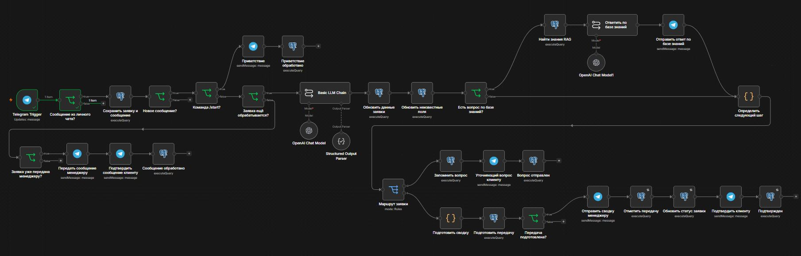
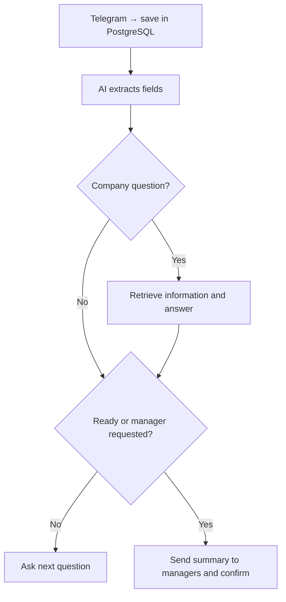
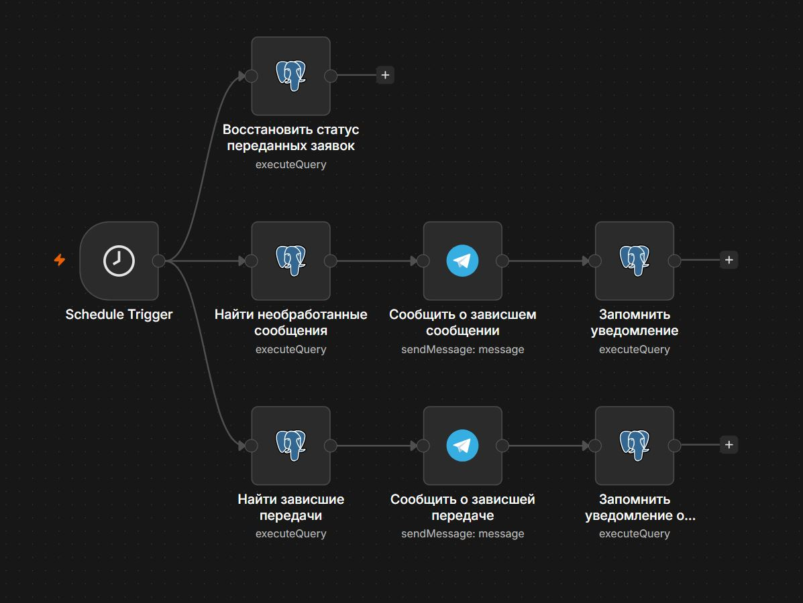

# Lead Intake & Handoff

[Русская версия](README_RU.md)

Telegram bot that collects apartment renovation requests, answers company questions and sends a summary to a manager group. Demo for a fictional company.

**Stack:** n8n · Telegram · PostgreSQL · JavaScript · OpenAI · Structured Output Parser · RAG

## What it does

- Collects renovation type, area, city, timing, budget and name; asks for missing details.
- Hands off when ready or when the customer requests a person. Forwards subsequent messages to the group.
- Answers from retrieved company information using PostgreSQL full-text search, then continues intake.
- Saves incoming messages before AI and alerts on stalled messages and handoffs.

## Workflow

Workflow logic

Monitoring and recovery

## Verified result

The bot collected renovation details, answered questions about company terms and delivered a summary and customer confirmation. Manual checks also covered an unknown budget, name refusal, early handoff and forwarding later messages.

**Demo limits:** one lead per chat, shared manager group and lexical retrieval during intake only. Ambiguous deliveries require manual review. Automatic redelivery is not implemented; clean deployment has not been tested.

## Run locally

Run both SQL files in `sql/`, import both workflows, assign credentials and replace chat ID placeholders.

**Documentation (Russian):** [Setup](docs/setup.md) · [Tests](docs/testing.md) · [Recovery](docs/recovery.md)

**Contact:** [Telegram](https://t.me/AlexZcv) · [Portfolio](https://alexzaytsev-ai.github.io/ai-portfolio/)
