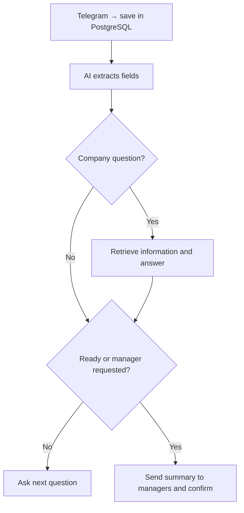

# Lead Intake & Handoff

[Русская версия](README_RU.md)

Telegram bot that collects apartment renovation requests, answers company questions and sends a summary to a manager group. Demo for a fictional company.

**Stack:** n8n · Telegram · PostgreSQL · JavaScript · OpenAI · Structured Output Parser

## What it does

- Collects renovation type, area, city, timing, budget and name; asks for missing details.
- Hands off when ready or when the customer requests a person. Forwards subsequent messages to the group.
- Answers from retrieved company information using PostgreSQL full-text search, then continues intake.
- Saves incoming messages before AI, alerts on stalled processing and restores one inconsistent lead status.

## Flow

## Verified result

Manual tests covered multi-step collection, unknown budget, name refusal, early handoff, knowledge answers and follow-up forwarding. The final test recorded `handed_off`, `sent`, `done` and both summary and confirmation message IDs.

**Limits:** one lead per chat, shared group without manager assignment, lexical retrieval during intake only. Ambiguous sends need manual review; automatic redelivery is not implemented. Clean deployment has not been tested.

## Setup

Run the two files in `sql/`, import both JSON files from `workflows/`, assign credentials and replace chat ID placeholders. [Setup details](docs/setup.md) · [Tests](docs/testing.md) · [Recovery](docs/recovery.md) (Russian).

**Author:** [Alexander Zaytsev](https://github.com/AlexZaytsev-ai). Built and tested with AI assistance.
