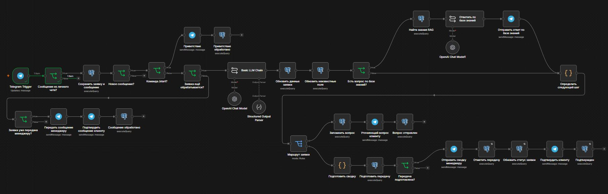
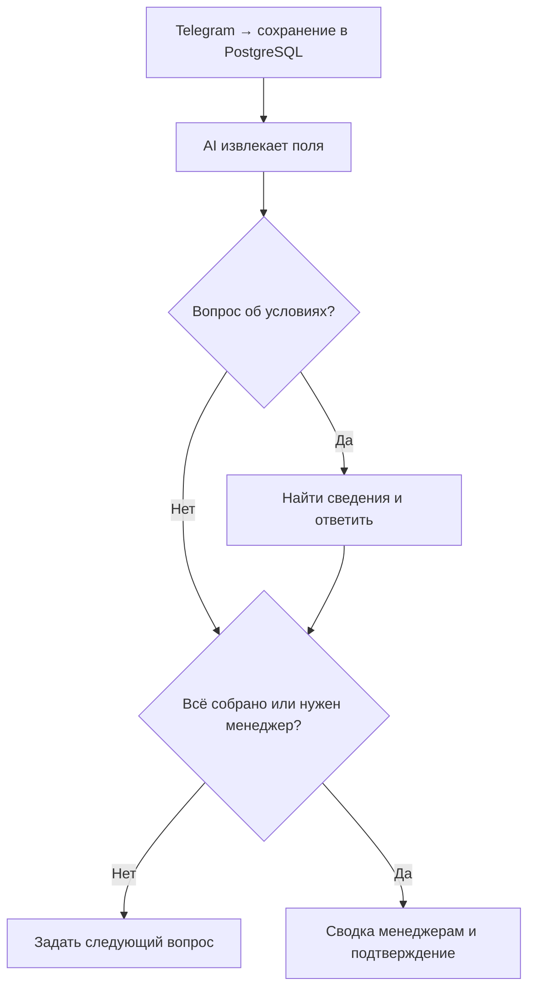
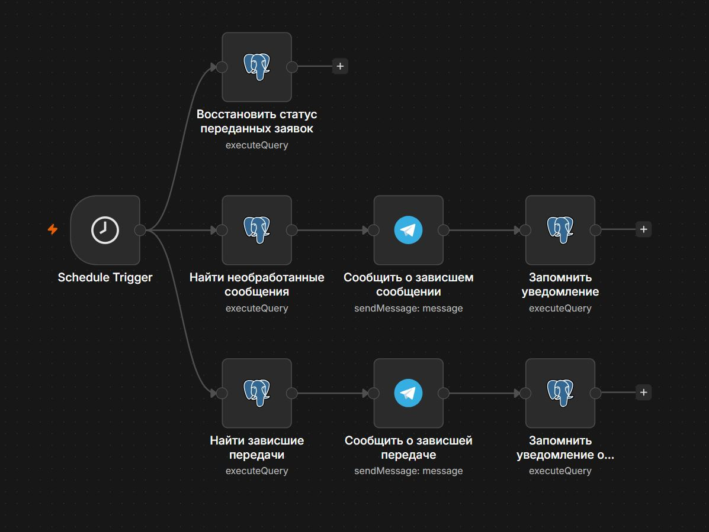

# Lead Intake & Handoff

[English version](README.md)

Telegram-бот собирает заявки на ремонт квартир, отвечает на вопросы об условиях и отправляет сводку в группу менеджеров. Демо для вымышленной компании.

**Стек:** n8n · Telegram · PostgreSQL · JavaScript · OpenAI · Structured Output Parser · RAG

## Что делает

- Собирает тип ремонта, площадь, город, сроки, бюджет и имя. Уточняет недостающие данные.
- Передаёт заявку после сбора или по просьбе клиента. Пересылает последующие сообщения в группу.
- Отвечает по найденным условиям компании через полнотекстовый поиск PostgreSQL, затем продолжает анкету.
- Сохраняет входящие сообщения до AI и предупреждает о зависших сообщениях и передачах.

## Workflow

Логика работы

Мониторинг и восстановление

## Проверенный результат

Бот собрал данные о ремонте, ответил на вопросы об условиях и отправил сводку менеджерам с подтверждением клиенту. Отдельно проверены неизвестный бюджет, отказ назвать имя, ранняя передача и пересылка дополнений.

**Границы демо:** одна заявка на чат, общая группа менеджеров, поиск по словам только до передачи. Спорные доставки проверяются вручную; автоматической повторной доставки нет. Развёртывание с нуля не проверено.

## Запуск

Выполнить оба SQL-файла из `sql/`, импортировать оба workflow, назначить credentials и заменить заполнители Chat ID.

**Документация:** [Настройка](docs/setup.md) · [Тесты](docs/testing.md) · [Восстановление](docs/recovery.md)

**Связаться:** [Telegram](https://t.me/AlexZcv) · [Портфолио](https://alexzaytsev-ai.github.io/ai-portfolio/)
