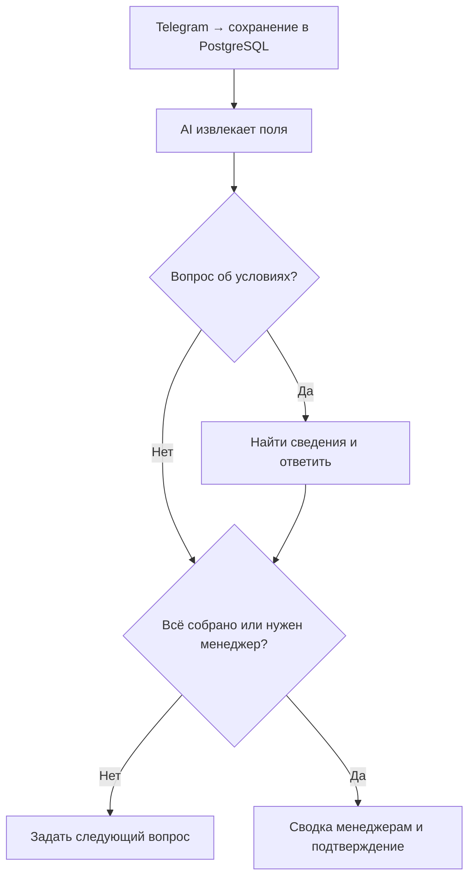

# Lead Intake & Handoff

[English version](README.md)

Telegram-бот собирает заявки на ремонт квартир, отвечает на вопросы об условиях и отправляет сводку в группу менеджеров. Демо для вымышленной компании.

**Стек:** n8n · Telegram · PostgreSQL · JavaScript · OpenAI · Structured Output Parser · RAG

## Что делает

- Собирает тип ремонта, площадь, город, сроки, бюджет и имя. Уточняет недостающие данные.
- Передаёт заявку после сбора или по просьбе клиента. Пересылает последующие сообщения в группу.
- Отвечает по найденным условиям компании через полнотекстовый поиск PostgreSQL, затем продолжает анкету.
- Сохраняет входящие сообщения до AI, предупреждает о зависаниях и восстанавливает один вид ошибки статуса.

## Схема

## Проверенный результат

Вручную проверены сбор по шагам, неизвестный бюджет, отказ назвать имя, ранняя передача, ответы по знаниям и пересылка дополнений. Итоговый тест завершился статусами `handed_off`, `sent`, `done` и сохранёнными ID сводки и подтверждения.

**Ограничения:** одна заявка на чат, общая группа без назначения менеджера, поиск по словам только до передачи. Спорные отправки проверяются вручную; автоматической повторной доставки нет. Развёртывание с нуля не проверено.

## Запуск

Выполнить два файла из `sql/`, импортировать оба JSON из `workflows/`, назначить credentials и заменить заполнители Chat ID. [Настройка](docs/setup.md) · [Тесты](docs/testing.md) · [Восстановление](docs/recovery.md).

**Автор:** [Alexander Zaytsev](https://github.com/AlexZaytsev-ai). Проект собран и проверен с помощью AI.
