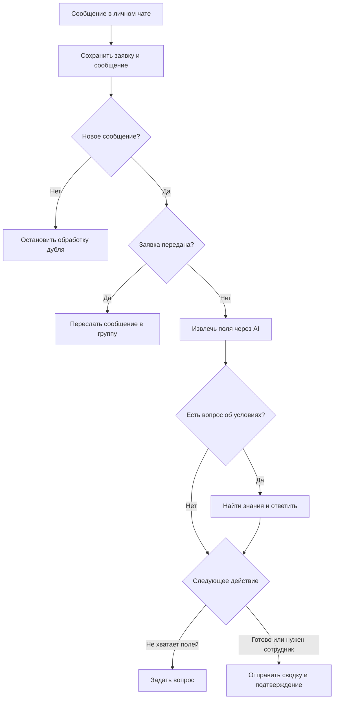

# Lead Intake & Handoff

[English version](README.md)

Демонстрационный Telegram-бот для вымышленной компании по ремонту квартир.

Бот собирает требования к ремонту, отвечает на вопросы по найденным сведениям о компании и отправляет сводку в общий чат менеджеров. Последующие сообщения клиента пересылаются в эту группу.

**Статус на 5 ноября 2026 года:** основной сценарий, RAG, отдельные крайние случаи, предупреждения мониторинга и восстановление одного вида статуса проверены вручную. Влияние на бизнес не измерялось.

**Состав репозитория:** два очищенных workflow, SQL для новой базы, вымышленные условия компании и документация. Публичные экспорты прошли статическую проверку JSON и связей. Развёртывание комплекта с нуля пока не проверено.

---

## Бизнес-задача

Клиенты описывают ремонт свободным текстом. Для дальнейшего разговора менеджеру нужны тип ремонта, площадь, город, сроки, бюджет и контакт. Бот собирает сведения, отвечает на вопросы об условиях и готовит сводку. Клиент может сразу попросить сотрудника.

Расчёт сметы, запись на выезд и коммерческие договорённости не автоматизированы.

## Моя роль

Определил демонстрационный сценарий, собрал и настроил workflow, подключил Telegram, PostgreSQL и OpenAI, проверил диалог и передачу с контролем записей в базе.

Проект разрабатывался с помощью AI. В моей работе были настройка структурированного извлечения, проверка SQL и маршрутов, разбор повторных вопросов, разделение имени клиента и профиля Telegram, сверка фактических отправок со статусами.

## Архитектура workflow

Схема показывает бизнес-логику. В JSON также есть фильтр личных чатов, приветствие `/start` и SQL-ноды фиксации отправок и обработки сообщения.

## Как работает

1. Фильтр исключает сообщения группы менеджеров до создания заявки.
2. PostgreSQL сохраняет заявку и входящий текст до обращения к AI. Уникальное ограничение и IF отсекают повтор того же Telegram message ID в рамках заявки.
3. Модель извлекает поля текущего сообщения через Structured Output Parser. SQL объединяет непустые результаты с собранными данными.
4. При вопросе об условиях модель выделяет тему поиска. PostgreSQL возвращает до трёх фрагментов, отдельная AI-цепочка формирует ответ. После него анкета продолжается.
5. JavaScript выбирает следующий вопрос или передачу. При явной просьбе сотрудника заполнение анкеты не обязательно.
6. Создаётся передача `pending`. После отправки сводки сохраняются её Telegram ID и статус `sent`.
7. Заявка получает `handed_off`. После подтверждения клиенту сохраняется его ID, исходное сообщение получает `done`.
8. Последующие сообщения направляются в группу. Обратная доставка ответов менеджеров клиенту не реализована.

## Данные и состояния

| Таблица | Назначение |
| --- | --- |
| `leads` | Контакт, собранные и пропущенные поля, статус |
| `messages` | Входящие тексты и обработка |
| `handoffs` | Сводка, получатель и ID первичных отправок |
| `repair_knowledge` | Шесть тем для поиска |

| Запись | Основной реализованный переход |
| --- | --- |
| Заявка | `collecting` → `handed_off` |
| Передача | `pending` → `sent` |
| Сообщение | `pending` → `done` |

Другие допустимые значения в ограничениях БД не означают наличие соответствующих веток workflow.

## Поиск знаний

Используется полнотекстовый поиск PostgreSQL с русской конфигурацией. Модель преобразует вопрос, например «Работаете официально?», в тему «договор». Найденные фрагменты передаются цепочке ответа.

Это RAG с лексическим поиском, без embeddings и pgvector. Если ответа нет, бот предлагает уточнить вопрос у менеджера. Сам этот ответ не создаёт задачу менеджеру и не добавляет вопрос в сводку.

## Обработка сбоев

У трёх SQL-нод настроены три попытки с интервалом в секунду. Слепой повтор Telegram-отправок не включён: сообщение могло дойти до потери ответа.

Мониторинг предупреждает о сообщениях и передачах `pending` старше пяти минут. Повторное предупреждение допускается не чаще раза в час на запись.

Отдельная ветка исправляет `collecting` на `handed_off`, если передача уже `sent`, Telegram ID сохранён и с отправки прошло больше пяти минут. Это проверено на искусственно изменённой тестовой записи.

Спорные отправки проверяются вручную. Автоматической повторной доставки и гарантии «ровно один раз» нет. Подробнее: [восстановление](docs/recovery.md).

## Основные решения

- Сохранять входящий текст до AI, чтобы после сбоя осталась запись для разбора.
- Разделить `client_name` и имя профиля Telegram `first_name`.
- Выбирать следующий шаг явными правилами JavaScript.
- Передавать значения в SQL через параметры.
- Сохранять ID сводки и подтверждения для разбора доставки.
- Хранить условия компании в отдельной редактируемой таблице.
- Отделить мониторинг от клиентского диалога.
- Использовать общий чат без назначения ответственного.

## Стек

| Технология | Назначение |
| --- | --- |
| n8n | Workflow, маршрутизация, мониторинг |
| Telegram | Диалог, группа менеджеров, предупреждения |
| OpenAI API | Извлечение полей и темы поиска, ответы по фрагментам |
| Structured Output Parser | Обязательные поля и типы JSON |
| PostgreSQL | Состояние, ограничения и полнотекстовый поиск |
| JavaScript | Выбор вопросов, выражения и сводка |

## Импорт и настройка

1. Создать пустую БД, выполнить `sql/001_schema.sql` и `sql/002_demo_knowledge.sql`.
2. Импортировать `workflows/lead-intake.json` и `workflows/monitoring.json`.
3. Назначить credentials Telegram, PostgreSQL и OpenAI. В экспорте выбрана `gpt-4.1`, доступ нужно проверить.
4. Заменить заполнители адресов чатов по [инструкции](docs/setup.md).
5. Явно настроить расписание мониторинга и пройти [приёмочный сценарий](docs/testing.md) перед включением.

Экспорты отключены, привязки credentials, адреса чатов, webhook ID, служебные метаданные и отдельные тестовые ноды удалены. Схема воссоздана для новой базы, это не миграция и не точный pg_dump.

## Проверенные сценарии и результат

В настроенной среде проверены:

- Заполнение одним сообщением и по шагам.
- Неизвестный бюджет и отказ назвать имя после вопроса об имени.
- Просьба сотрудника до завершения анкеты.
- Сводка в группе и последующие сообщения.
- Вопросы об условиях одновременно с данными заявки.
- Ответы про договор и гарантию, отсутствие выдуманных условий ипотеки.
- Восстановление статуса и подробное предупреждение о зависшем сообщении.

**Результат:** итоговый тест сохранил правильные поля и обе первичные отправки, завершился статусами `handed_off`, `sent`, `done`. После замены удалённой тестовой группы проверена пересылка дополнения в новую группу. Первичная сводка в новую группу отдельно ещё не проверялась.

Точная новая формулировка при отсутствии знаний включена в экспорт, но отдельно в Telegram не перепроверялась. Подробности: [тестирование](docs/testing.md).

## Текущие ограничения

Одна заявка на Telegram-чат; нет повторной заявки, закрытия и назначения менеджера. RAG работает только до передачи и использует лексический поиск. Пропуск полей распознаётся ограниченным набором выражений; массив `unknown_fields` от модели сейчас не используется при сохранении.

Нет автоматического продолжения после сбоя; защита от дублей также может остановить восстановление. Поддержан только текст. Вложения, параллельные сообщения, длинные тексты и устойчивость к prompt injection требуют доработки и проверки.

Чистый импорт и запуск схемы в отдельной среде не выполнялись. Полные ограничения: [заметки о реализации](docs/implementation-notes.md). Сценарий записи и вопросы для собеседования: [демонстрация](docs/demo-and-interview.md).

## Автор

Alexander Zaytsev

AI Automation Engineer

- GitHub: [AlexZaytsev-ai](https://github.com/AlexZaytsev-ai)
